# Decoding Child Malnutrition: Wasting Trends, Wealth and Mother's Education

*A Python-Based Exploratory Data Analysis of WHO Child Wasting Data*

**Author:** Muhammad Safad V | **Batch:** DA54

   

## Table of Contents

1. [Abstract](#abstract)
2. [Introduction](#introduction)
3. [Problem Statement](#problem-statement)
4. [Project Objectives](#project-objectives)
5. [Dataset Description](#dataset-description)
6. [Main Dataset Variables](#main-dataset-variables)
7. [Tools and Technologies Used](#tools-and-technologies-used)
8. [Data Loading and Initial Inspection](#data-loading-and-initial-inspection)
9. [Data Cleaning and Preprocessing](#data-cleaning-and-preprocessing)
10. [Exploratory Data Analysis (EDA)](#exploratory-data-analysis-eda)
11. [Data Visualization](#data-visualization)
12. [Key Findings and Insights](#key-findings-and-insights)
13. [Recommendations](#recommendations)
14. [Conclusion](#conclusion)
15. [Limitations and Future Scope](#limitations-and-future-scope)
16. [References](#references)

---

## Abstract

This project analyses global child wasting data published by the World Health Organization (WHO). Wasting, defined as low weight for height, is a key indicator of acute malnutrition among children under five years of age. The dataset contains 57,967 records for 164 countries, covering the years 1983 to 2024, with wasting rates broken down by household wealth, mother’s education, urban or rural residence, child sex and child age group.

The main objective is to clean and preprocess the data, perform exploratory and statistical analysis, and present the findings through suitable visualisations. Python was used in Google Colab for the full workflow. Pandas and NumPy supported data handling and calculations, while Matplotlib, Seaborn and Plotly were used to create charts. Data-cleaning steps included renaming columns, handling missing values, checking duplicates, data types, invalid and inconsistent values, standardising country names and detecting outliers with the IQR method.

The average wasting rate is 6.34% and the median is 5.1%, with rates ranging from 0% to 48.9%. Wasting falls steadily from about 7.5% in the poorest wealth quintile to about 5.2% in the richest, and from about 7.2% when the mother has no or only primary education to about 4.4% when she has higher education. Wasting is highest in the first year of life, boys have a higher rate than girls, and rural children have a slightly higher rate than urban children. Using each country’s latest survey, about 63% of countries have low or very low wasting (below 5%), while about 10% have high or very high wasting.

Overall, the project shows how Python-based exploratory data analysis can reveal patterns in child nutrition data that are useful for public health planning. The findings describe associations and do not prove that any single factor causes higher or lower wasting.

## Introduction

Child malnutrition remains one of the most serious public health challenges in the world. Wasting, measured as low weight for height, reflects recent and severe weight loss and increases a child’s risk of illness and death. The WHO and other agencies track wasting through household surveys so that governments can identify where children are most at risk and where nutrition programmes should be focused.

This project analyses the WHO wasting indicator for children under five. The dataset reports the percentage of children who are wasted, along with lower and upper confidence bounds, for many countries and survey years. Several records are further broken down by household wealth, mother’s education, urban or rural area, sex and age group.

Python was used to perform data cleaning, preprocessing, exploratory data analysis, statistical analysis and data visualisation. The analysis aims to identify patterns in wasting and to understand how wealth, maternal education, age, sex and place of residence are associated with it.

## Problem Statement

The WHO child wasting dataset contains tens of thousands of records across many countries, survey years and population groups. Because the data is stored with many breakdown columns that are empty by design, with several coding schemes and with right-skewed rates, it is difficult to identify trends, patterns and relationships by inspecting the data manually. Therefore, this project aims to use Python to clean the dataset, perform statistical analysis and create visualisations in order to understand how child wasting varies with household wealth, mother’s education, urban or rural residence, sex, age and time.

## Project Objectives

The main objectives of this project are:

1.  To analyse global trends in wasting among children under 5 across countries and years.

2.  To examine how household wealth influences child wasting rates.

3.  To study the relationship between mother’s education level and child wasting.

4.  To compare wasting across urban and rural areas, sex and age groups.

5.  To handle missing values, duplicate records, data-type issues, inconsistent labels and outliers using Python.

6.  To study relationships between numerical variables using correlation analysis.

7.  To visualise the data using appropriate charts and graphs.

8.  To extract actionable public-health insights from the 57,967 WHO records using Python-based exploratory data analysis.

## Dataset Description

The dataset used for this project is the WHO indicator on wasting in children under five years of age. The World Health Organization (WHO) is the specialised agency of the United Nations responsible for international public health. The file was loaded in Google Colab as a CSV file and stored in a DataFrame named df.

The dataset contains numerical and categorical columns. The target variable is the wasting rate (RATE_PER_100_N, renamed wasting_pct), which is the percentage of children under five who are wasted. Each record also has a lower and an upper confidence bound for this rate.

**Table 1: Dataset information**

| **Attribute**     | **Description**                                     |
|-------------------|-----------------------------------------------------|
| Source            | World Health Organization (WHO)                     |
| Indicator         | Wasting in children (under 5)                       |
| Number of records | 57,967                                              |
| Number of columns | 22                                                  |
| Countries covered | 164                                                 |
| Years covered     | 1983 to 2024                                        |
| Target variable   | Wasting rate (RATE_PER_100_N, % of children)        |
| Data types        | Numerical and categorical                           |
| Type of analysis  | Exploratory Data Analysis (EDA)                     |
| Duplicate rows    | 0                                                   |
| Source URL        | <https://data.who.int/indicators/i/6461116/FC5231F> |

## Main Dataset Variables

After renaming, the 22 columns of the dataset can be grouped as follows.

| **Variable Group** | **Columns**                                                                         |
|--------------------|-------------------------------------------------------------------------------------|
| Indicator details  | indicator_id, indicator_code, indicator_uuid, indicator_period_code, indicator_name |
| Time               | year, time_type                                                                     |
| Geography          | country, country_code, geo_type                                                     |
| Publication        | publish_status                                                                      |
| Residence and sex  | urbanity, sex                                                                       |
| Wealth breakdowns  | wealth_group, wealth_decile, wealth_quintile, wealth_tercile                        |
| Mother’s education | mother_edu                                                                          |
| Child age          | age_group                                                                           |
| Wasting measures   | wasting_pct (rate), ci_low (lower bound), ci_high (upper bound)                     |
| Derived columns    | wasting_level, period (created during analysis)                                     |

Wealth quintiles are labelled WQ1 (poorest) to WQ5 (richest). Child age is grouped into six bands from 0–5 months to 48–59 months.

## Tools and Technologies Used

The following tools and libraries were used for data cleaning, exploratory data analysis and visualisation.

#### 1. Python

Python was used as the primary programming language for data cleaning, preprocessing, analysis and visualisation.

#### 2. Google Colab

Google Colab was used as the cloud-based environment to write and run the Python code.

#### 3. Pandas

Pandas was used to load the dataset, inspect it, handle missing values, check duplicates, group data and create summary tables.

#### 4. NumPy

NumPy was used for numerical operations and calculations.

#### 5. Matplotlib

Matplotlib was used to create charts and graphs for understanding distributions and trends.

#### 6. Seaborn

Seaborn was used for statistical visualisations, including histograms, box plots, bar plots, count plots, scatter plots, a pair plot and a correlation heatmap.

#### 7. Plotly Express

Plotly was used to create interactive pie charts that show the share of countries in each wasting level and the share of records by sex.

## Data Loading and Initial Inspection

The dataset was loaded into Python using the Pandas function read_csv() from the file RELAY_WHS (6).csv in Google Colab and stored in a DataFrame named df. Before any cleaning, the structure of the data was inspected using the following methods:

- df.head() to view the first five rows and understand the layout of the data.

- df.shape to find the size of the dataset. The result was **57,967 rows and 22 columns**.

- df.columns to list the column names. The original names were uppercase codes such as IND_ID, DIM_TIME, GEO_NAME_SHORT, DIM_DEG_URB, DIM_SEX, DIM_AGE, RATE_PER_100_N, RATE_PER_100_NL and RATE_PER_100_NU.

- df.describe() to get a statistical summary of the numerical columns, shown below.

- df.info() and df.dtypes to check data types and non-null counts (see Data Cleaning and Preprocessing).

**Table: Statistical summary of the original numerical columns**

| **Statistic** | **DIM_TIME (year)** | **RATE_PER_100_N** | **RATE_PER_100_NL** | **RATE_PER_100_NU** |
|---------------|---------------------|--------------------|---------------------|---------------------|
| count         | 57,967              | 57,967             | 55,740              | 55,740              |
| mean          | 2008.77             | 6.34               | 4.62                | 9.26                |
| std           | 8.90                | 5.16               | 4.44                | 6.40                |
| min           | 1983                | 0.0                | 0.0                 | 0.0                 |
| 25%           | 2002                | 2.3                | 1.2                 | 4.5                 |
| 50%           | 2010                | 5.1                | 3.3                 | 8.0                 |
| 75%           | 2016                | 9.0                | 6.8                 | 12.4                |
| max           | 2024                | 48.9               | 34.0                | 63.9                |

The summary shows that the wasting rate (RATE_PER_100_N) ranges from 0% to 48.9% with a mean of 6.34%, and that the lower and upper confidence bounds have only 55,740 non-missing values, which means 2,227 values are missing in each. This guided the missing-value handling in the next section.

## Data Cleaning and Preprocessing

Data cleaning and preprocessing were performed in Python using Google Colab. The dataset was first inspected using head(), shape, columns and describe(), which showed 57,967 rows and 22 columns. Missing values, duplicates, data types, invalid values, inconsistent values and outliers were then checked and handled using Pandas methods.

### 1. Renaming Columns

The original column names were abbreviated or unclear, for example DIM_POP_WEALTH_QUINTILE and RATE_PER_100_N. They were renamed using the rename() function to short, descriptive snake_case names. Some of the main changes are listed below.

| **Original name**       | **New name**    |
|-------------------------|-----------------|
| DIM_TIME                | year            |
| GEO_NAME_SHORT          | country         |
| DIM_DEG_URB             | urbanity        |
| DIM_POP_EDU_LEVELMOTHER | mother_edu      |
| DIM_POP_WEALTH_QUINTILE | wealth_quintile |
| DIM_SEX                 | sex             |
| DIM_AGE                 | age_group       |
| RATE_PER_100_N          | wasting_pct     |
| RATE_PER_100_NL         | ci_low          |
| RATE_PER_100_NU         | ci_high         |

### 2. Handling Missing Values

Missing values were identified using isnull().sum(). The breakdown columns were found to have many missing values, and the confidence bounds had 2,227 missing values each.

**Table 2: Missing values before handling**

| **Column**      | **Missing values** |
|-----------------|--------------------|
| urbanity        | 55,584             |
| wealth_group    | 53,981             |
| mother_edu      | 54,563             |
| wealth_decile   | 56,418             |
| wealth_quintile | 54,651             |
| sex             | 24,752             |
| wealth_tercile  | 56,826             |
| age_group       | 11,488             |
| ci_low          | 2,227              |
| ci_high         | 2,227              |

The columns were handled in two ways:

- **Numerical columns (`ci_low`, `ci_high`):** missing values were filled with the median of each column, because the median is less sensitive to extreme values.

- **Breakdown columns (sex, urbanity, wealth and education columns, age group):** these are empty by design, because each record reports only one breakdown at a time. They were filled with the label NOT_APPLICABLE so that records can still be filtered correctly.

After handling, the dataset contained no missing values (total missing values = 0).

### 3. Removing Duplicate Records

Duplicate rows were checked using duplicated().sum(). No duplicate records were found (0 duplicate rows), so no rows were removed and the dataset remained at 57,967 records.

### 4. Data Type Check

Data types were examined using dtypes and info(). The numerical columns (year, country_code, wasting_pct, ci_low, ci_high) already had suitable numeric types, and the remaining columns were categorical text. No type conversion was required.

### 5. Checking Invalid Values

Invalid values were checked using explicit validity rules: wasting rates must be between 0 and 100, the lower bound must not exceed the upper bound, years must lie between 1983 and 2024, and category labels must be valid.

- All wasting rates are between 0 and 100, all years lie between 1983 and 2024, and ci_low is never greater than ci_high.

- The checks on sex, urbanity and wealth labels flagged 24,752, 55,584 and 54,651 rows respectively. These counts are exactly the numbers of NOT_APPLICABLE placeholders added in the missing-value step, so they are not genuine errors.

- In 705 records ci_low is greater than wasting_pct, and in 751 records ci_high is lower than wasting_pct. These are most likely a side effect of filling missing bounds with the column median. They were retained and are listed as a limitation of the analysis.

### 6. Checking Inconsistent Values

The country column contains 164 unique countries. No extra spaces, capitalisation differences or unusual values were found. All text columns were standardised using str.strip(). The mother_edu column contains two coding schemes (EDUC\_\* and NHLM, PRLM, SHLM), so only the EDUC\_\* codes (no or primary, secondary, higher) were used in the analysis.

### 7. Standardising Country Names

Long official country names were replaced with commonly used names so that charts and tables are easier to read, for example “Russian Federation” to “Russia”, “United States of America” to “United States”, “Viet Nam” to “Vietnam” and “Republic of Korea” to “South Korea”. The number of unique countries stayed at 164.

### 8. Outlier Detection and Handling

Outliers were detected using the Interquartile Range (IQR) method. IQR = Q3 − Q1, and values below Q1 − 1.5 × IQR or above Q3 + 1.5 × IQR were treated as potential outliers.

**Table 3: IQR outlier results**

| **Column**  | **Q1** | **Q3** | **IQR** | **Lower limit** | **Upper limit** | **Outliers** |
|-------------|--------|--------|---------|-----------------|-----------------|--------------|
| wasting_pct | 2.3    | 9.0    | 6.7     | −7.75           | 19.05           | 1,603        |
| ci_low      | 1.2    | 6.6    | 5.4     | −6.90           | 14.70           | 2,078        |
| ci_high     | 4.6    | 12.2   | 7.6     | −6.80           | 23.60           | 1,887        |

All three columns have outliers only on the high side, because the lower limits are below zero. These are very high wasting rates in some countries and population groups, so they represent genuine observations and were retained rather than removed.

### 9. Handling Irrelevant or Incorrect Data

Some data in the file is not relevant to a given analysis, so it was handled as follows:

- Rows labelled NOT_APPLICABLE or TOTAL are not separate groups, so they were excluded from group comparisons (for example wealth, education and residence).

- Each record reports only one breakdown at a time, so a helper function was used to keep only the rows of the breakdown being studied. This avoids mixing different breakdowns in the same chart.

- The mother_edu column mixes two coding schemes. Only the EDUC\_\* codes were kept, and the NHLM, PRLM and SHLM codes were left out of the education analysis.

- The pair plot used a random sample of 3,000 rows (random_state=42) to keep the chart readable.

## Exploratory Data Analysis (EDA)

### 1. Statistical Analysis

Statistical analysis was performed to understand the characteristics, distribution and relationships in the data. Descriptive statistics summarised the numerical variables, categorical and numerical variables were examined separately, and correlation analysis was used to study relationships.

#### 1.1 Descriptive Analysis

The mean, median, mode and standard deviation of the numerical variables are shown below.

**Table 4: Descriptive statistics**

| **Variable** | **Mean** | **Median** | **Mode** | **Std Dev** |
|--------------|----------|------------|----------|-------------|
| wasting_pct  | 6.34     | 5.1        | 1.9      | 5.16        |
| ci_low       | 4.57     | 3.3        | 3.3      | 4.36        |
| ci_high      | 9.22     | 8.0        | 8.0      | 6.28        |
| year         | 2008.77  | 2010       | 2000     | 8.90        |

- **Wasting rate:** the mean (6.34%) is higher than the median (5.1%), so a few very high rates pull the average up. The standard deviation of 5.16 is large compared with the mean, so wasting rates vary widely across countries and groups. Rates range from 0% to 48.9%.

- **Confidence bounds:** ci_low and ci_high show the same pattern. Their modes equal their medians because missing values were filled with the median.

- **Year:** the mean is 2008.8 and the median is 2010, so most records come from recent years.

#### 1.2 Categorical Data Analysis

Rows marked NOT_APPLICABLE or TOTAL were excluded, since they are not separate groups.

- **Sex:** male (15,541 records) and female (15,443 records) are almost equal.

- **Urbanity:** urban (630) and rural (632) have nearly the same number of records.

- **Wealth quintile:** each quintile has about 435 to 441 records, so the wealth groups are balanced.

- **Mother’s education:** the groups are not equal. No or primary education has the most records (426) and higher education the fewest (328).

- **Countries:** Peru has the most records (1,707), followed by Kuwait (1,520), Jamaica (1,309), Niger (1,191) and Senegal (1,153). Malta has only 4 records. The median country has about 289 records.

- **Age groups:** the six child age groups each have about 2,140 to 2,230 records.

These counts show how many data rows each group has, not how many children. Balanced counts mean each group has similar coverage, which makes group comparisons fair.

#### 1.3 Percentage Analysis

Percentage analysis was used to express counts as shares of the whole. Wasting rates were grouped into severity levels using commonly used prevalence thresholds: very low (below 2.5%), low (2.5% to below 5%), medium (5% to below 10%), high (10% to below 15%) and very high (15% or above).

**Table 5: Wasting severity levels**

| **Wasting level**   | **National records (%)** | **Countries, latest survey (%)** |
|---------------------|--------------------------|----------------------------------|
| Very low (\<2.5%)   | 24.8                     | 33.5                             |
| Low (2.5 to \<5%)   | 23.6                     | 29.9                             |
| Medium (5 to \<10%) | 30.7                     | 26.2                             |
| High (10 to \<15%)  | 14.3                     | 7.3                              |
| Very high (≥15%)    | 6.6                      | 3.0                              |

Using each country’s latest survey, about 63% of countries have low or very low wasting, while about 10% have high or very high wasting. About 20% of all records have a wasting rate of 10% or more.

#### 1.4 Group Comparison

Average wasting rates were compared across groups using groupby().

| **Group**          | **Category**                   | **Average wasting (%)**        |
|--------------------|--------------------------------|--------------------------------|
| Wealth quintile    | Poorest (WQ1) to richest (WQ5) | about 7.5 falling to about 5.2 |
| Mother’s education | No or primary                  | about 7.2                      |
|                    | Secondary                      | about 5.4                      |
|                    | Higher                         | about 4.4                      |
| Residence          | Rural                          | about 6.8                      |
|                    | Urban                          | about 6.0                      |
| Child sex          | Boys                           | about 6.9                      |
|                    | Girls                          | about 5.7                      |
| Child age          | 0 to 11 months                 | about 9.2 to 9.3               |
|                    | 36 to 47 months                | about 4.7                      |

#### 1.5 Cross Tabulation

To compare groups with different numbers of rows, wasting rates were classified into Low, Medium and High levels (using the 33rd and 67th percentiles) and cross-tabulated with wealth, mother’s education and residence. The row percentages are shown below.

**Table 6: Wealth quintile vs wasting level (row %)**

| **Wealth quintile** | **Low** | **Medium** | **High** |
|---------------------|---------|------------|----------|
| WQ1 (poorest)       | 26.0    | 30.4       | 43.6     |
| WQ2                 | 31.5    | 32.2       | 36.3     |
| WQ3                 | 32.3    | 34.4       | 33.3     |
| WQ4                 | 32.4    | 37.8       | 29.7     |
| WQ5 (richest)       | 38.2    | 37.9       | 23.9     |

**Table 7: Mother’s education vs wasting level (row %)**

| **Mother’s education** | **Low** | **Medium** | **High** |
|------------------------|---------|------------|----------|
| No or primary          | 27.7    | 30.0       | 42.3     |
| Secondary              | 38.2    | 35.8       | 26.0     |
| Higher                 | 54.1    | 27.2       | 18.7     |

**Table 8: Urban vs rural and wasting level (row %)**

| **Area** | **Low** | **Medium** | **High** |
|----------|---------|------------|----------|
| Rural    | 30.4    | 33.2       | 36.4     |
| Urban    | 34.4    | 34.2       | 31.4     |

#### 1.6 Correlation Analysis

Correlation analysis measured the strength and direction of linear relationships between the numerical variables.

**Table 9: Correlation matrix**

|             | **wasting_pct** | **ci_low** | **ci_high** | **year** |
|-------------|-----------------|------------|-------------|----------|
| wasting_pct | 1.00            | 0.95       | 0.88        | −0.07    |
| ci_low      | 0.95            | 1.00       | 0.80        | −0.03    |
| ci_high     | 0.88            | 0.80       | 1.00        | −0.09    |
| year        | −0.07           | −0.03      | −0.09       | 1.00     |

wasting_pct has a very strong positive correlation with ci_low (0.95) and a strong one with ci_high (0.88). This is expected, because the confidence bounds are calculated around the wasting rate, so it is not a new finding. year has very weak negative correlations with all other variables (−0.03 to −0.09), so there is almost no linear change in wasting with year when all countries are combined. Correlation indicates association and does not imply causation.

## Data Visualization

Data visualisation was performed in Python to show the patterns, distributions and relationships in the child wasting dataset. Different charts were used to understand the distribution of variables, compare wasting across groups and periods, and study relationships between numerical variables.

### 1. Histograms of Numerical Variables

Histograms with density curves show how the values of wasting_pct, ci_low, ci_high and year are spread across ranges.

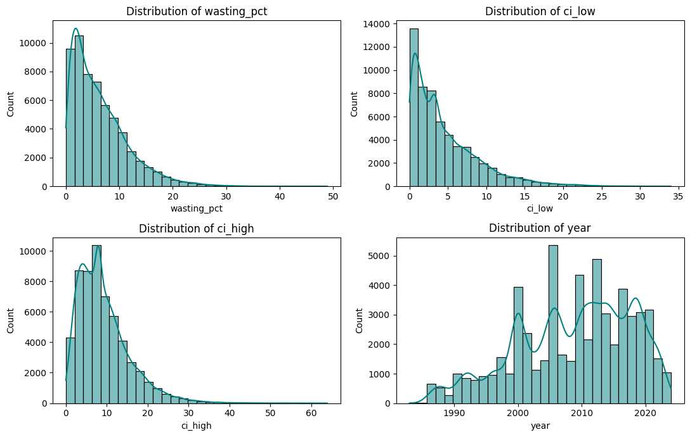

*Figure 1: Distribution of numerical variables*

wasting_pct, ci_low and ci_high are all right-skewed. Most values are low, and a long tail stretches to the right up to 48.9%, 34% and 63.9%. About 80% of records have a wasting rate of 10% or less, so very high wasting is rare. ci_low and ci_high show a spike at their medians (3.3% and 8.0%) because missing values were filled with the median. About 85% of the records are from after 2000, with a sharp drop after 2022, so the latest years have less data.

### 2. Box Plots of Numerical Variables

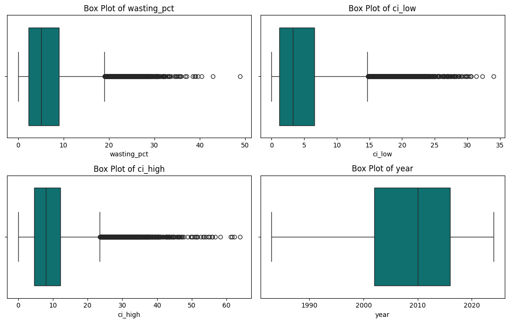

*Figure 2: Box plots of numerical variables*

The middle 50% of wasting rates lies between about 2.4% and 9.1%, with a median of 5.1%. The longer right whisker confirms the right skew. wasting_pct, ci_low and ci_high have extreme values only on the high side (above about 19%, 15% and 24%), which make up about 3% of the records and are real high-wasting cases. ci_high has the widest box. year has no outliers, and its middle 50% lies between 2002 and 2016.

### 3. Count Plots of Categorical Variables

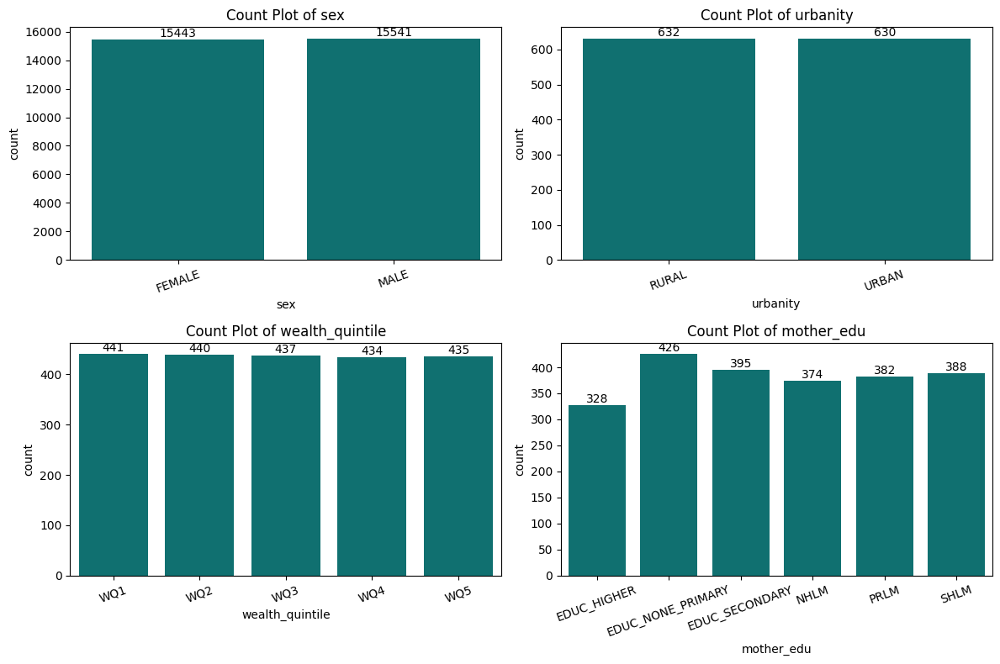

*Figure 3: Count plots of sex, urbanity, wealth quintile and mother’s education*

Male and female records, and urban and rural records, are almost equal in number, and the five wealth quintiles are balanced. Mother’s education is less balanced, with no or primary education having the most records.

### 4. Top 10 Countries by Number of Records

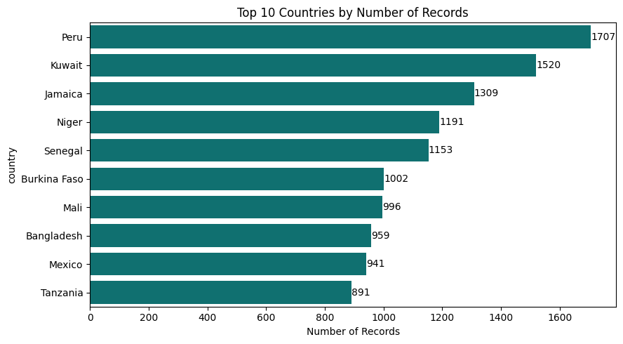

*Figure 4: Top 10 countries by number of records*

Peru has the most records, followed by Kuwait, Jamaica, Niger and Senegal. The top 10 countries together make up about 20% of all records, so the data is spread across many countries. These counts show data coverage, not the severity of wasting.

### 5. Records by Child Age Group

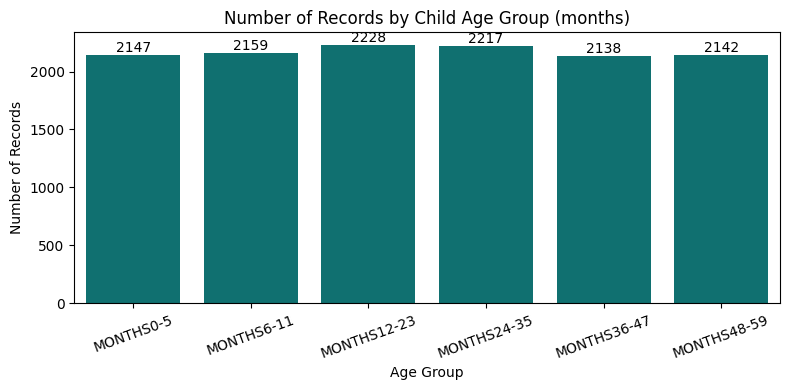

*Figure 5: Number of records by child age group*

The six age groups have almost the same number of records, so comparisons across age groups are balanced.

### 6. Scatter Plot: Lower Confidence Bound vs Wasting Rate

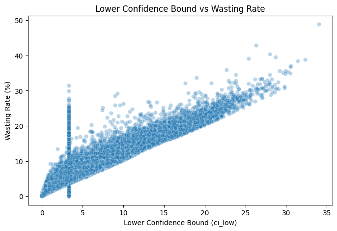

*Figure 6: Lower confidence bound vs wasting rate*

The points form a tight upward line (correlation about 0.95), so records with a higher wasting rate also have a higher lower bound.

### 7. Upper Confidence Bound vs Wasting Rate

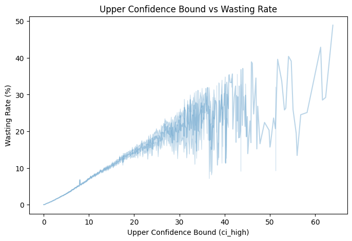

*Figure 7: Upper confidence bound vs wasting rate*

The relationship is also strongly positive (about 0.88), but the points are more spread out, because high rates carry more uncertainty. These strong relationships are expected, since the bounds are calculated around the rate.

### 8. Scatter Plot: Year vs Wasting Rate

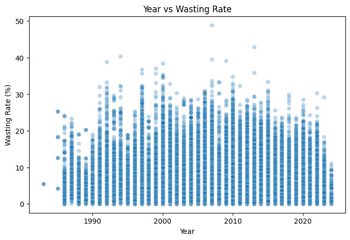

*Figure 8: Year vs wasting rate*

The points form a flat cloud with almost no pattern (correlation about −0.07), so wasting does not change much with year when all countries are combined. The highest wasting values (above 40%) occur before 2020, and the highest value in the data (48.9%) is from 2007.

### 9. Wealth Quintile vs Wasting Rate

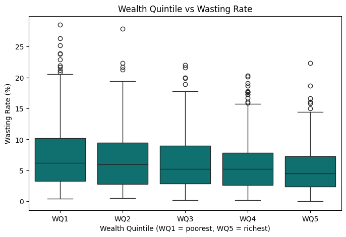

*Figure 9: Wealth quintile vs wasting rate (box plot)*

Wasting falls steadily from about 7.5% in the poorest quintile (WQ1) to about 5.2% in the richest (WQ5).

### 10. Mother’s Education vs Wasting Rate

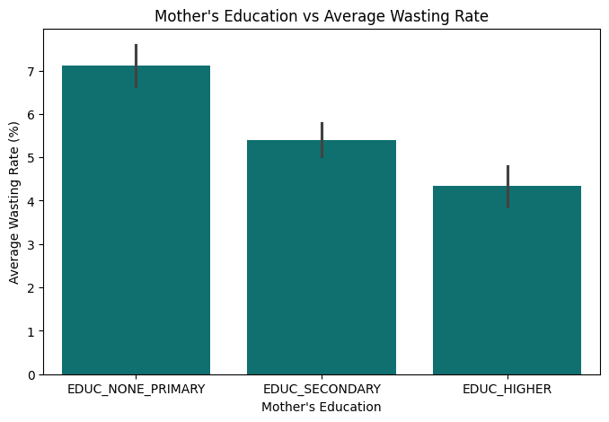

*Figure 10: Mother’s education vs average wasting rate*

Average wasting is about 7.2% when the mother has no or only primary education, 5.4% with secondary education and 4.4% with higher education.

### 11. Urban vs Rural Wasting Rate

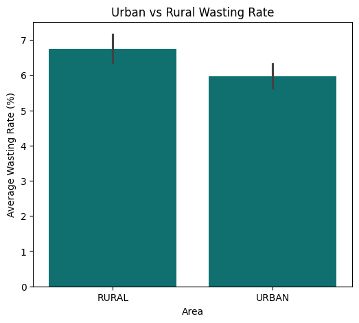

*Figure 11: Urban vs rural wasting rate*

Rural children (6.8%) have a slightly higher average wasting rate than urban children (6.0%), but the gap is small.

### 12. Child Age Group vs Wasting Rate

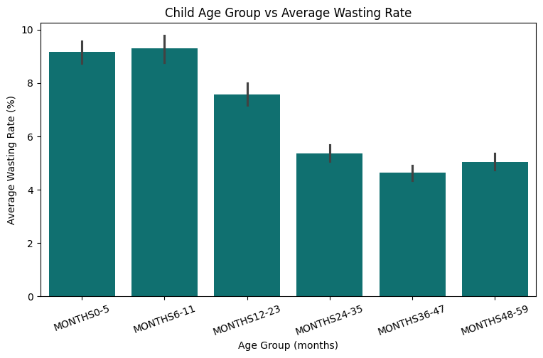

*Figure 12: Child age group vs average wasting rate*

Wasting is highest in the first year of life (about 9.2% to 9.3% at 0 to 11 months) and falls to about 4.7% at 36 to 47 months. The first year of life is the most vulnerable age.

### 13. Wealth Quintile vs Wasting Level

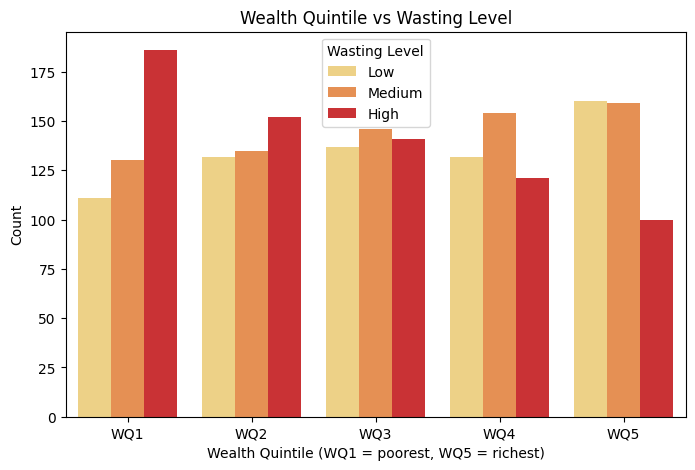

*Figure 13: Wealth quintile vs wasting level*

The share of High wasting is largest in the poorest quintiles and smallest in the richest (43.6% in WQ1 compared with 23.9% in WQ5; see Table 6).

### 14. Mother’s Education vs Wasting Level

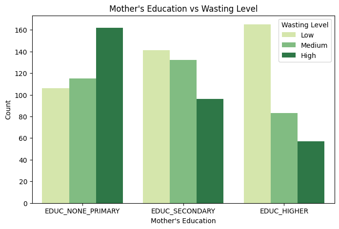

*Figure 14: Mother’s education vs wasting level*

High wasting is most common when the mother has no or only primary education (42.3%) and least common with higher education (18.7%; see Table 7).

### 15. Urban vs Rural and Wasting Level

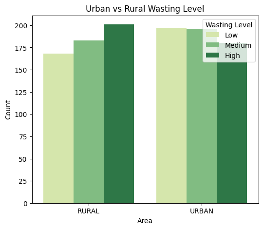

*Figure 15: Urban vs rural wasting level*

Rural areas have a somewhat larger share of High wasting than urban areas (36.4% compared with 31.4%; see Table 8), but the difference is small.

### 16. Correlation Heatmap

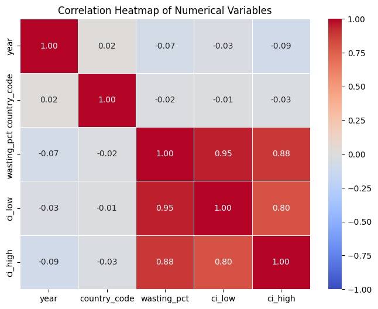

*Figure 16: Correlation heatmap of numerical variables*

The heatmap shows the strongest positive correlation between wasting_pct and ci_low (about 0.95), followed by wasting_pct and ci_high (about 0.88). The correlation between year and wasting_pct is about −0.07, a very weak negative relationship. These results show association and do not establish causation.

### 17. Wasting Rate by Child Age Group and Sex

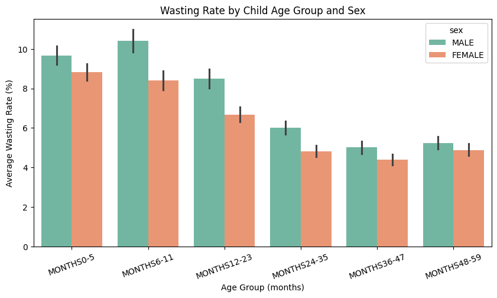

*Figure 17: Wasting rate by child age group and sex*

Boys have a higher wasting rate than girls in every age group. The gap is largest at 6 to 11 months (about 10.5% for boys and 8.4% for girls). Wasting is highest in the first year of life for both sexes and falls to about 4.4% to 5.3% after 3 years.

### 18. Wasting Rate by Wealth Quintile and Time Period

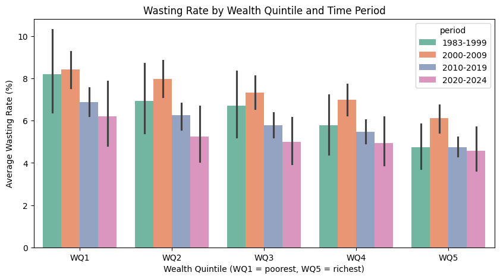

*Figure 18: Wasting rate by wealth quintile and time period*

The poorest quintile has the highest wasting in every period and the richest the lowest. The gap between them narrowed from about 3.5 percentage points in 1983–1999 to about 1.7 in 2020–2024, mainly because wasting fell in the poorest group (from about 8.2% to 6.3%) while the richest group stayed near 4.6% to 4.8%.

### 19. Urban and Rural Wasting by Time Period

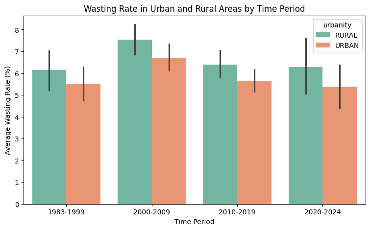

*Figure 19: Wasting rate in urban and rural areas by time period*

Rural areas have a higher wasting rate than urban areas in all four periods, by about 0.6 to 0.9 percentage points.

### 20. Pair Plot

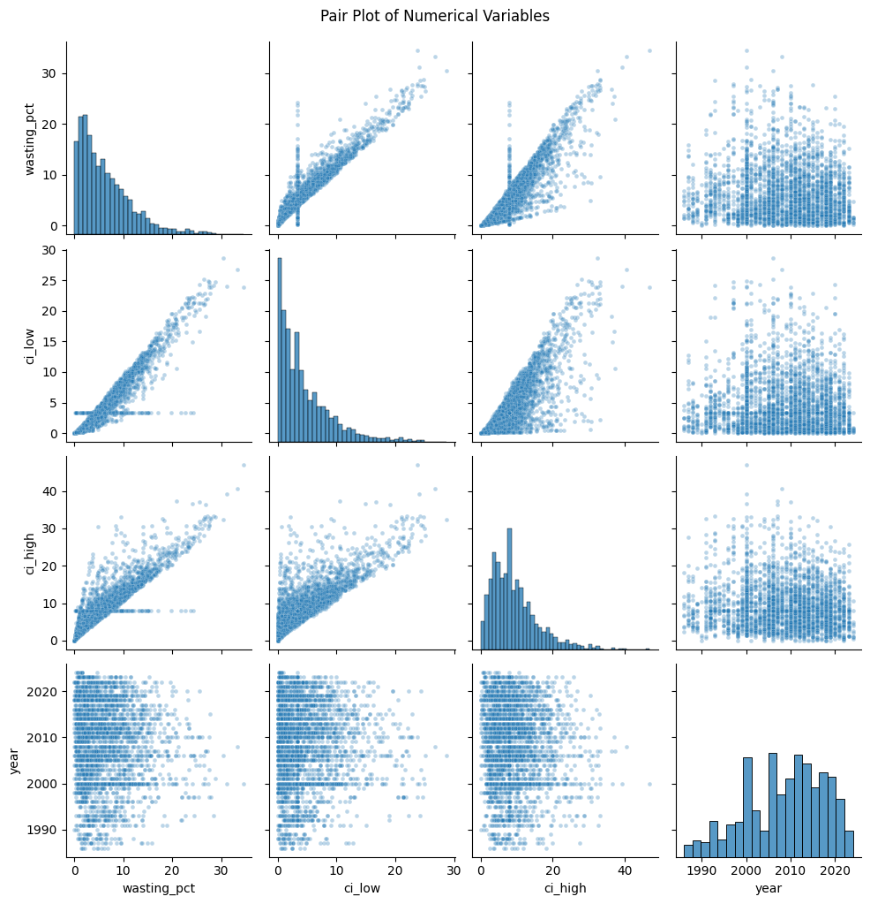

*Figure 20: Pair plot of numerical variables*

The diagonal histograms show right-skewed distributions for wasting_pct, ci_low and ci_high. The pairs of wasting rate with each bound form tight upward lines (about 0.95 and 0.88), and ci_low vs ci_high also shows a positive relationship (about 0.80). The year panels show a flat cloud with almost no pattern. Very high wasting values (above 30%) are rare and appear as isolated points.

### 21. Percentage of Countries by Wasting Level

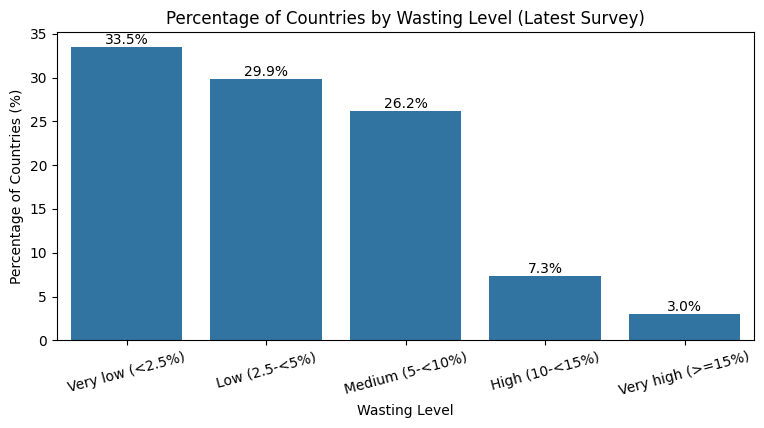

*Figure 21: Percentage of countries by wasting level (latest survey)*

Based on each country’s latest survey, 33.5% of countries have very low wasting and 29.9% have low wasting, while only 7.3% have high and 3.0% have very high wasting.

### Interactive Visualisation Using Plotly

#### 22. Pie Chart: Countries by Wasting Level

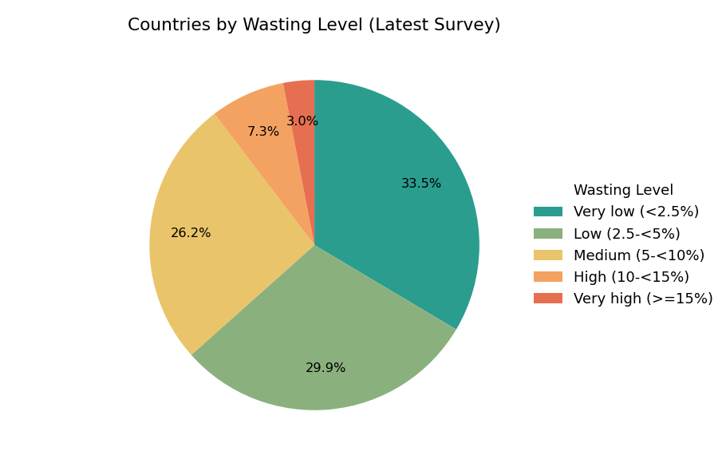

*Figure 22: Countries by wasting level, latest survey (pie chart)*

About 33.5% of countries (55) have very low wasting and 29.9% (49) have low wasting, so about 63.4% of countries have a wasting rate below 5%. Another 26.2% (43) are at the medium level, while only 7.3% (12) have high wasting and 3.0% (5) very high wasting. The largest share of countries falls in the very low level and the very high level is the smallest group. In the notebook this chart is interactive: hovering over a slice shows its values.

#### 23. Pie Chart: Share of Records by Sex

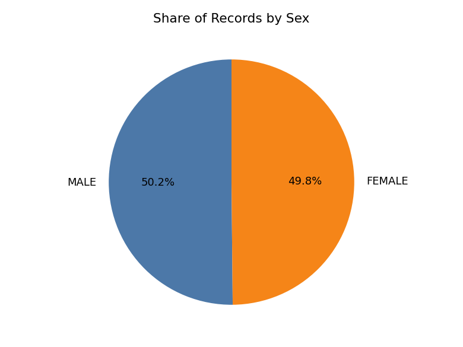

*Figure 23: Share of records by sex (pie chart)*

Male records (15,541) and female records (15,443) are almost equal, each about 50% of the sex-specific records, so the sex groups are balanced.

## Key Findings and Insights

1.  **Wasting distribution:** the average wasting rate is 6.34% and the median is 5.1%, with rates from 0% to 48.9%. The data is right-skewed because a few countries and groups have very high rates.

2.  **Severity levels:** using each country’s latest survey, about 63% of countries have low or very low wasting (below 5%), 26% have medium wasting and about 10% have high or very high wasting. About 3% are at the very high level (15% or more).

3.  **Household wealth:** wasting falls steadily from about 7.5% in the poorest quintile to about 5.2% in the richest, which suggests an association between poverty and higher wasting.

4.  **Mother’s education:** wasting is about 7.2% when the mother has no or only primary education, 5.4% with secondary education and 4.4% with higher education.

5.  **Age and sex:** wasting is highest in the first year of life (about 9% to 10% at 0 to 11 months) and falls to about 5% after 3 years. Boys (6.9%) have a higher average rate than girls (5.7%), and the gap is largest at 6 to 11 months.

6.  **Urban vs rural:** rural children (6.8%) have a slightly higher rate than urban children (6.0%), and rural areas are higher in every time period, but the gap is small.

7.  **Trend and correlation:** the notebook’s summary reports that the average national wasting rate fell from about 7.5% in 2000 to about 5.2% in 2024, while the linear correlation between year and wasting is very weak (about −0.07). Wasting is strongly correlated with its confidence bounds (0.95 and 0.88), which is expected.

8.  **Data quality:** the breakdown columns were empty by design and were marked NOT_APPLICABLE, the confidence bounds were filled with the median, and no duplicates were found. Potential outliers (1,603 in wasting_pct) were retained because they are real high-wasting cases.

#### Overall Insight

Wealth, mother’s education and the child’s age show the clearest differences in wasting. Younger children, boys, poorer households, children of mothers with less education and rural areas tend to have higher wasting. High wasting is serious in a smaller group of countries and populations, even though most countries have low wasting.

## Recommendations

Based on the analysis of the WHO child wasting dataset, the following recommendations are suggested:

- **Focus on the first year of life:** wasting is highest at 0 to 11 months, so nutrition support and screening should give priority to infants and young children.

- **Target the poorest households:** the poorest wealth quintile has the highest wasting in every period, so programmes can be directed to low-income families.

- **Support mothers’ education and awareness:** children of mothers with no or only primary education have the highest wasting, so education and nutrition awareness for mothers may help.

- **Pay attention to rural areas:** rural children have higher wasting than urban children in every period, even though the gap is small.

- **Prioritise high-wasting countries:** the small group of countries at the high and very high levels should be monitored most closely.

- **Improve data quality and coverage:** countries with very few records and the sharp drop in data after 2022 should be addressed through regular, up-to-date surveys. Missing confidence bounds should be verified against the source instead of being filled with the median.

These recommendations are based on associations found in the data. They are not proof of cause and effect and should be combined with local public-health expertise.

## Conclusion

This project applied Python-based data cleaning, exploratory data analysis, statistical analysis and visualisation to the WHO child wasting dataset covering 164 countries from 1983 to 2024. After handling missing values, checking duplicates, data types, invalid and inconsistent values and outliers, the analysis examined how wasting varies with household wealth, mother’s education, age, sex, residence and time.

The findings show that wasting is higher among children in poorer households, children whose mothers have less education, infants in their first year of life, boys and rural children. Most countries have low wasting, but a smaller group still faces high or very high levels. The visualisations made these patterns easier to interpret, and the project also shows the importance of careful data cleaning before drawing conclusions. The findings show patterns associated with child wasting but do not establish that any single factor directly causes higher or lower wasting.

## Limitations and Future Scope

### Limitations

- The averages are unweighted, and survey years and countries differ across time periods, so comparisons across periods should be made carefully.

- The analysis identifies associations and does not establish cause and effect.

- Missing confidence bounds were filled with the median, which created spikes at the median values and may explain why some bounds fall on the wrong side of the wasting rate (705 and 751 records).

- The mother_edu column mixes two coding schemes, and only the EDUC\_\* codes were used, so some records were left out of the education analysis.

- Counts in the charts show the number of data rows, not the number of children.

- The latest years (after 2022) have much less data, which weakens conclusions about recent trends.

- Wealth, education, residence and age breakdowns are reported in separate rows, so combined effects (for example wealth and education together) could not be studied.

### Future Scope

- Population-weighted averages could be used to give a more accurate picture at the regional and global level.

- Country-level and regional trend analysis could show which countries have improved or worsened over time.

- Statistical modelling, such as regression, could be used to estimate the effect of wealth, education and other factors on wasting.

- More recent WHO data could be added, together with other nutrition indicators such as stunting and underweight.

- An interactive dashboard using a tool such as Power BI could present the key findings and trends more effectively.

## References

1.  World Health Organization – Wasting in children under 5 (indicator data): <https://data.who.int/indicators/i/6461116/FC5231F>

2.  Google Colab: <https://colab.research.google.com/>
